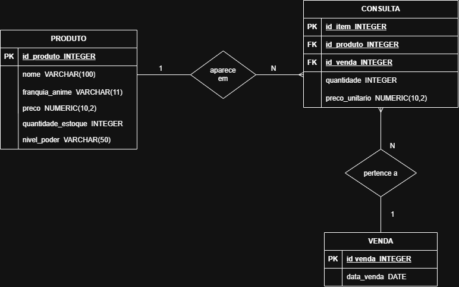

# Sistema Geek Store
Este repositório contém o projeto desenvolvido para o cliente Geek Store.

O objetivo do sistema é auxiliar no controle de estoque de action figures, permitindo cadastrar produtos, registrar informações como nome, franquia, preço e quantidade disponível, além de controlar a entrada e a saída de produtos do estoque.

## MER — Geek Store
### 1. Entidades
- Produto: armazena as informações dos bonecos de ação vendidos pela loja.
- Movimentação de Estoque: registra as entradas e saídas de produtos do estoque.
### 2. Atributos
- Produto:
- id_produto — identificador do produto (PK).
- nome — nome do boneco.
- franquia — franquia ou anime ao qual o boneco pertence.
- preco — preço do produto em reais.
- quantidade_estoque — quantidade disponível em estoque.
- nivel_poder — nível de poder do personagem, caso esse campo seja utilizado.
- Movimentação de Estoque:
- id_movimentacao — identificador da movimentação (PK).
- id_produto — identificador do produto (FK).
- tipo_movimentacao — entrada ou saída de produtos.
- quantidade — quantidade de unidades movimentadas.
- data_movimentacao — data da movimentação.
### 3. Relacionamento
- Um produto pode ter várias movimentações de estoque.
- Cada movimentação está associada a um único produto.
- A cardinalidade do relacionamento é 1:N (um para muitos).
### 4. Regras de negócio
- Cada produto possui um identificador único.
- O sistema deve registrar o nome, a franquia ou anime, o preço e a quantidade disponível de cada produto.
- A entrada de produtos aumenta a quantidade em estoque.
- A venda ou saída de produtos diminui a quantidade em estoque.
- O sistema não deve permitir que a quantidade em estoque fique negativa.
- O nível de poder pode ser registrado como informação adicional do personagem, se esse requisito tiver sido confirmado com o cliente.

